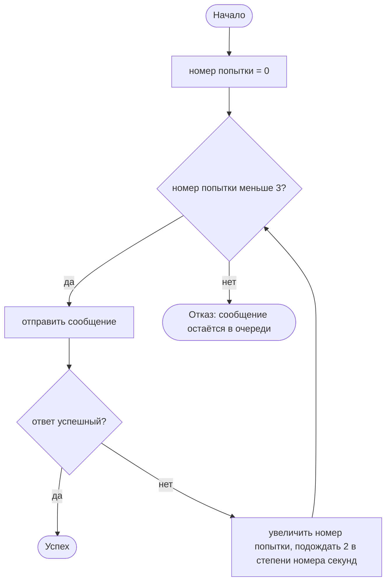

# Блок-схемы алгоритмов (Mermaid)

Решено 2026-10-31 (выбор пользователя): блок-схема в Mermaid, только для алгоритмов с ветвлениями или циклами.

## Правила

- Схема показывает **последовательность шагов алгоритма**, поэтому шаги живут в схеме, а не в тексте блока `АЛГОРИТМ` (текст остаётся без шагов: зачем, что делает, формула).
- Один алгоритм — одна схема, не больше примерно 12 блоков. Больше — разбить на два алгоритма.
- Тексты блоков словами на русском, без синтаксиса языка и вызовов библиотек. Текст блока заключай в двойные кавычки: так не ломают разметку скобки, запятые и двоеточия.
- Начало и конец — скруглённые блоки `([…])`, действие — прямоугольник `[…]`, условие — ромб `{…}`. Выходы из условия подписываются («да», «нет»).
- Каждый цикл виден стрелкой назад; каждый путь заканчивается блоком конца.
- Схема лежит в заметке сразу под блоком `АЛГОРИТМ «Название»`, в обычном блоке кода с языком `mermaid`; Obsidian рисует её сам.
- Синтаксис, в котором не уверена (стили, подграфы, стрелки особого вида), сверь с документацией Mermaid или не используй; на всякий случай держись простого `flowchart TD`.
- Подпись «моё предложение» ставится над схемой, пока пользователь её не принял.

## Пример (иллюстрация, алгоритм из стандарта)

```
АЛГОРИТМ «Повтор отправки с нарастающей паузой»
    зачем: пережить кратковременный сбой сети, не заваливая сервер
    делает: при неудаче повторяет отправку до 3 раз, удваивая паузу
    вход: сообщение m
    результат: успех или отказ (при отказе сообщение остаётся в очереди)
    обозначения: k — номер попытки; 2^k — два в степени k
    формула: пауза перед попыткой k равна 2^k секунд, k = 1, 2, 3
```



Алгоритм без ветвлений и циклов (например, «Оценить важность заметки», одна формула) схемы не получает.
